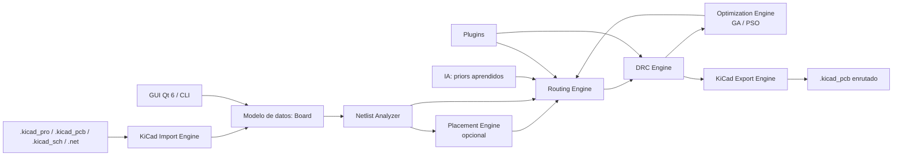

# Arquitectura de OpenRouteAI

## Modelo de datos (`core/model.py`)
- `Board`: capas de cobre, huellas, redes, clases de red, reglas, pistas, vías, zonas, contorno y el
  árbol S-expr original completo (para reescribir el archivo sin perder nada).
- `Pad` es el **nodo** eléctrico: posición, capas, restricciones (vía su clase de red), prioridad y clase.
- Grafos (`analysis/netlist_analyzer.py`): grafo de componentes (peso = redes compartidas) y grafo de
  conexiones (árbol de expansión mínima por red).
- Grafo espacial / matriz de ocupación / mapa de congestión (`routing/grid.py`).
- `ai.learn.export_graph` exporta los tres grafos con atributos por nodo (JSON).

## Rejilla y legalidad (`routing/grid.py`)
Rejilla 3D de paso automático `(ancho + clearance) / 3` (≈ 0,15 mm por defecto). Para cada celda se
precalcula la distancia **exacta** al cobre fijo más cercano (`d1`, propietario `o1`) y al de otro
propietario (`d2`). Para la red *n*, la distancia a cobre ajeno es `d1` si `o1 ≠ n`, si no `d2`.
Una celda vale como eje de pista si esa distancia ≥ semiancho + clearance (+0,02 mm de margen).
El cobre enrutado se registra por clase de anchura y la ocupación se evalúa con un filtro máximo de
disco; así la congestión es una medida continua apta para PathFinder.

## Búsqueda (`routing/search.py`)
Estados `(capa, y, x)`; 8 vecinos (0/45/90°) más transiciones de vía. Costes: longitud × (1 + histórico)
× (1 + factor presente × ocupación) × penalización de dirección por capa + penalización de giro.

## Enrutado (`routing/router.py`)
- *PathFinder*: iteraciones de reenrutado completo; tras cada una se detectan conflictos,
  se incrementa el coste histórico de esas celdas y el factor presente se multiplica (×1,7).
  Al final, si quedan conflictos se retiran las redes peores y se reintentan en modo estricto.
- *Secuencial / rip-up*: modo estricto (el cobre ajeno bloquea); si falla, se busca una ruta
  permitiendo cruces muy penalizados, se levantan las redes que estorban y se reencolan.
- Planos: la red del plano baja a la capa del plano con una vía corta desde cada pad SMD;
  los pads pasantes ya conectan. Las capas internas de plano quedan reservadas.

## DRC (`drc/drc.py`)
Geometría continua (polígonos convexos + radio), índice espacial por celdas de 2 mm,
conectividad por unión-búsqueda (incluye zonas), longitudes, desfase de pares y plugins.

## Exportación (`kicad/pcb_export.py`)
Se copia el árbol original, se añaden `segment`, `via` y `zone` con el estilo de red del archivo
(numerado o por nombre) y UUID nuevos, y se actualizan las posiciones de huellas si se colocaron.
